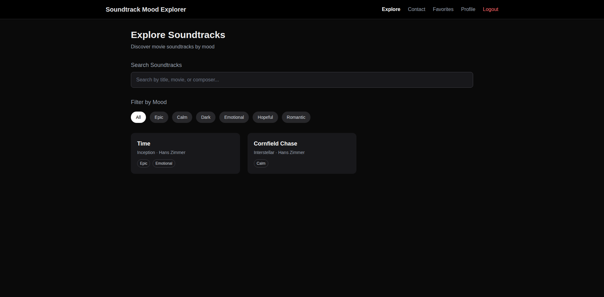
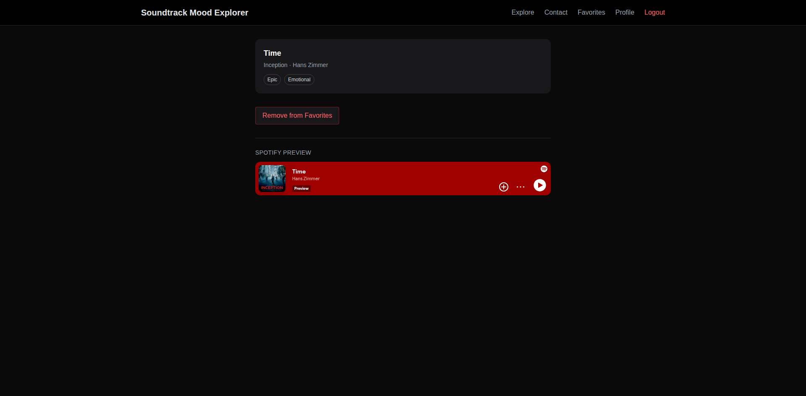
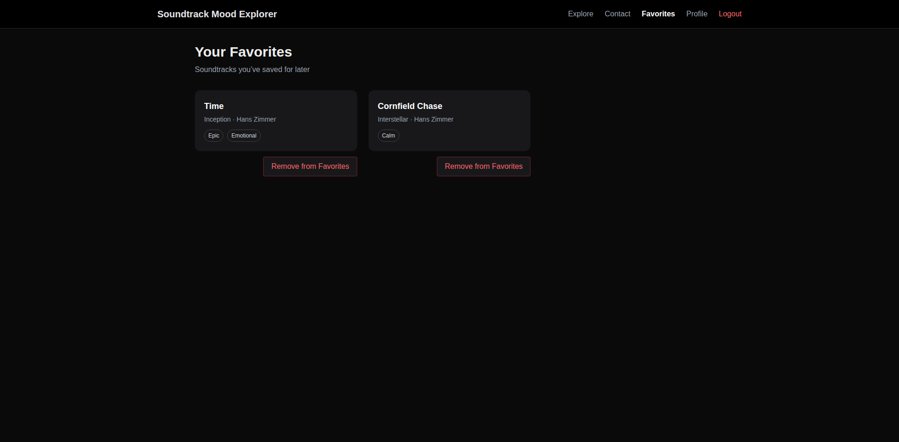
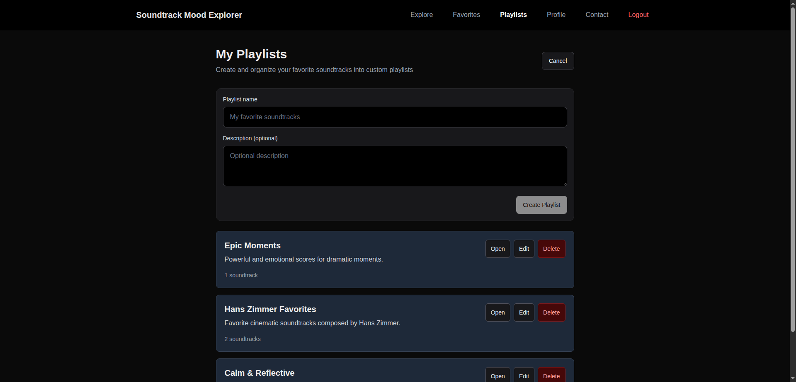
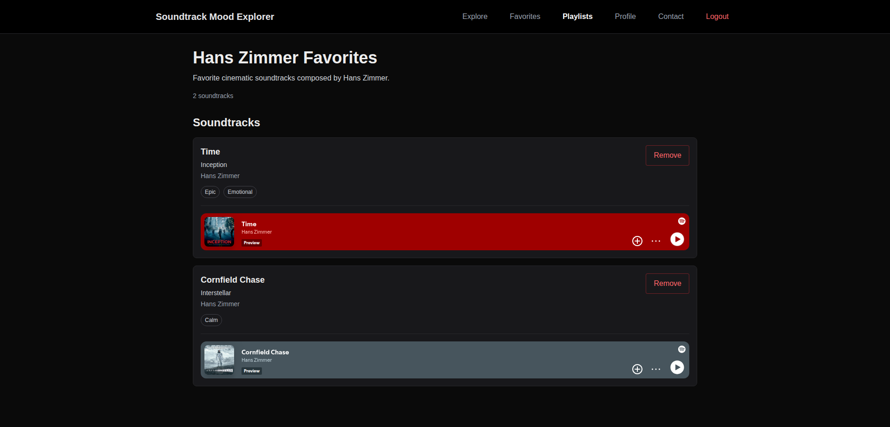
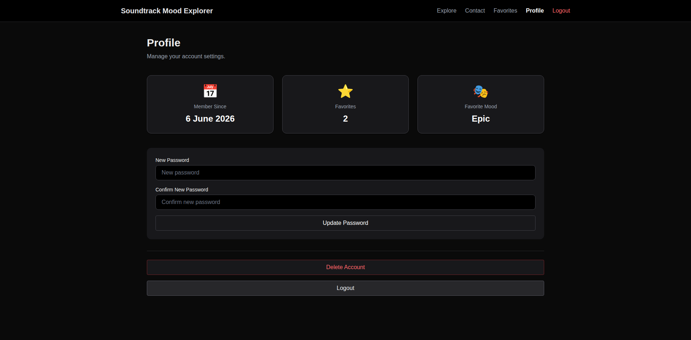
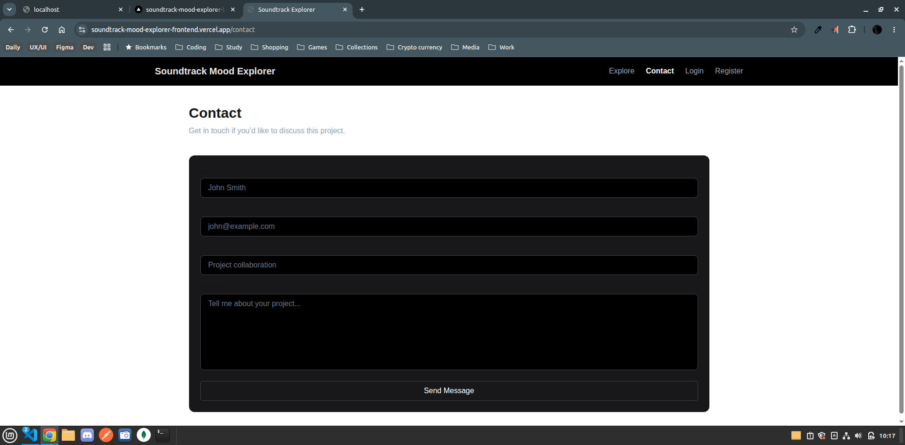

# 🎬 Soundtrack Mood Explorer — Frontend


[](https://github.com/Frantisek82/soundtrack-mood-explorer-frontend/actions/workflows/frontend-ci.yml)

Frontend application for Soundtrack Mood Explorer, a full-stack portfolio project for discovering and organizing movie soundtracks by mood.

This application allows users to:

- Discover movie soundtracks
- Filter by mood
- View detailed soundtrack information
- Preview tracks via Spotify
- Register & login securely
- Save and manage favorites
- Create and manage custom soundtrack playlists
- View personal profile statistics
- Contact the developer through a built-in contact form

Built as a modern full-stack portfolio project showcasing secure authentication, responsive UI design, accessibility, and REST API integration.

---

## 🚀 Features

- 🎵 Browse movie soundtracks
- 🔍 Search by title, movie or composer
- 🎭 Filter by mood
- ⭐ Persistent favorites
- 🎼 Custom soundtrack playlists
- 👤 Profile statistics
- 📬 Contact form with email delivery
- 🔐 Secure authentication
- 🎧 Spotify preview integration
- ♿ Accessible UI
- 📱 Responsive design
- 🎨 Consistent Heroicons throughout the UI
- ✨ Smooth card hover animations
- ⏳ Improved loading skeletons

---

## 🚀 Deployment

- Frontend: Vercel
- Backend: Vercel
- Database: MongoDB Atlas
- Email: Resend

Authentication uses secure httpOnly cookies with cross-origin support.

---

## 🌐 Live Demo

- **Frontend:** https://soundtrack-mood-explorer-frontend.vercel.app
- **Backend API:** https://soundtrack-mood-explorer-backend.vercel.app

---

## 🔐 Authentication (v1.4.0)

Authentication is now implemented using **httpOnly cookies**:

- Token is stored securely in a cookie (not accessible via JS)
- All requests use `credentials: "include"`
- Protected pages validate auth via backend (`/api/user/me`)
- Logout clears cookie server-side

👉 This replaces the previous `localStorage`-based approach and aligns with production best practices.

---

## 🌐 Browser Compatibility

Earlier application versions were checked during development on:

- Google Chrome (Linux)
- Google Chrome (Windows)
- Safari (iOS)

The application is built using modern web standards and is expected to work in other current Chromium-based browsers, but only the browsers listed above have been verified.

### Note

Spotify OAuth verification on Chrome and Safari/iOS remains pending. Test with normal privacy protections enabled. If cross-site cookies prevent a workflow, record the limitation rather than requiring users to weaken browser privacy settings.

---

## ⭐ Favorites

- Add and remove favorites
- Persistent across sessions
- Synced with MongoDB
- Real-time UI updates

---

## 🎼 Custom Playlists (v2.1.0)

Authenticated users can organize soundtracks into personalized collections:

- Create playlists with a name and optional description
- View, rename, and delete playlists
- Add soundtracks from the soundtrack detail page
- Prevent duplicate soundtracks within the same playlist
- View playlist soundtrack counts and details
- Remove soundtracks from playlists
- Preview playlist tracks through Spotify
- Access playlists across authenticated sessions
- Use responsive, keyboard-accessible playlist controls

Playlist data is securely associated with the authenticated user and persisted in MongoDB.

---

## 📸 Screenshots

### Explore Page



### Soundtrack Detail



### Favorites Page



### Playlists Page



### Playlist Detail



### Profile Page



### Contact Page



---

## 🛠 Tech Stack

- Next.js (App Router)
- React
- TypeScript
- Tailwind CSS
- Heroicons
- Jest
- React Testing Library
- GitHub Actions
- REST API communication
- Resend
- Vercel

---

## 🌍 Environment Configuration

For local development, set these values in the ignored `.env.local`:

```dotenv
NEXT_PUBLIC_API_URL=http://127.0.0.1:3000/api
NEXT_PUBLIC_SPOTIFY_ENABLED=false
```

Keep Spotify disabled by default. Enable it locally only for controlled
allowlisted-account tests with the corresponding backend configuration.
Preview deployments disable Spotify controls regardless of the feature flag.

Development:

```
Backend: http://127.0.0.1:3000
```

```
Frontend: http://127.0.0.1:3001
```

Production:

```
Backend: https://soundtrack-mood-explorer-backend.vercel.app
```

```
Frontend: https://soundtrack-mood-explorer-frontend.vercel.app
```

---

## 🌍 API Configuration

Development:

```
http://127.0.0.1:3000/api
```

Production:

```
https://soundtrack-mood-explorer-backend.vercel.app/api
```

All authenticated requests include:

```
credentials: "include"
```

---

## ▶️ Running the Frontend

```bash
npm ci
npm run dev -- --hostname 127.0.0.1 --port 3001
```

Open:

```
http://127.0.0.1:3001
```

---

## 🧪 Testing

This project uses **Jest** and **React Testing Library** for frontend unit testing.

Run the test suite:

```bash
npm test
```

Run the test suite with code coverage:

```bash
npm run test:coverage
```

The automated test suite currently includes:

- Reusable UI components
- Shared service modules
- Utility functions
- Playlist services and reusable playlist components
- Playlist creation, editing, deletion, and soundtrack interactions
- Normal, loading, empty, error, and duplicate-addition scenarios

Validation on **22 October 2026** passed **22 test suites and 223 tests**, ESLint, standalone TypeScript validation, and the production build.

Historical v2.1.1 coverage (114 tests; not remeasured for the current branch):

- Statements: **96.57%**
- Branches: **94.66%**
- Functions: **93.44%**
- Lines: **97.22%**

Continuous Integration is configured with **GitHub Actions**, which automatically runs ESLint, the complete test suite, standalone TypeScript validation, and the production build on every push and pull request.

---

## 🔄 Continuous Integration

This project uses **GitHub Actions** for Continuous Integration.

On every push and pull request, the workflow automatically:

- Installs project dependencies using `npm ci`
- Runs ESLint validation with `npm run lint`
- Runs the complete Jest test suite
- Runs standalone TypeScript validation with `npx tsc --noEmit`
- Builds the production application with `npm run build`

This helps ensure that all changes are validated before being merged.

---

## 🌱 Seeding the Database

```js
fetch("http://127.0.0.1:3000/api/seed", { method: "POST" })
  .then((res) => res.json())
  .then(console.log);
```

---

## 📁 Project Structure

```
src/
├── app/
├── components/
├── lib/
├── services/
├── types/
└── utils/

docs/
└── screenshots/
```

---

## 🏗 Architecture

```text
User
  │
  ▼
Next.js Frontend
  │
  ▼
REST API
  │
  ▼
Next.js Backend
  │
  ▼
MongoDB Atlas
```

---

## 🏷 Version

Current version:

```text
v2.1.1
```

Release notes: [v2.1.1 – Maintenance & Hardening](https://github.com/Frantisek82/soundtrack-mood-explorer-frontend/releases/tag/v2.1.1)

---

## ✨ v2.1.1 Highlights

- 🎨 Improved soundtrack and playlist card-heading contrast in light mode
- 🧹 Resolved frontend ESLint findings without suppressions
- ✅ Added frontend ESLint validation to GitHub Actions
- 🧪 Validated 17 test suites with 114 passing tests
- 🔎 Added standalone TypeScript validation to the CI workflow
- 🚀 Retained automated production-build validation
- 🔒 Maintenance-only release with no new user-facing features

---

## ✨ v2.1.0 Highlights

- 🎼 Custom playlists with full create, view, rename, and delete functionality
- 🎵 Add and remove soundtracks from persistent playlist collections
- 🔍 Search soundtracks by title, movie, or composer
- 🎭 Combined search and mood filtering
- ⭐ Persistent favorites synchronized with MongoDB
- 👤 Profile statistics dashboard
- 📬 Functional contact form with email delivery
- 📅 Member Since information
- 🎼 Favorite count and most common mood
- 🧩 Reusable StatCard component
- 🔐 Secure authentication using httpOnly cookies
- 🎧 Spotify preview integration
- ♿ Accessible, keyboard-friendly interface
- 📱 Responsive design for desktop and mobile
- 🎨 Consistent Heroicons across reusable UI components
- ✨ Refined soundtrack card hover animations
- ⏳ Improved skeleton loading experience
- ♿ Enhanced accessibility for profile statistics
- 🧪 Automated unit testing for components, services, and utilities
- 🧪 Automated playlist service, component, and interaction testing
- ✅ Continuous Integration with GitHub Actions
- 🚀 Automated production build verification

---

## 🧩 Future Improvements

Future improvements are tracked through GitHub Issues.

Planned enhancements include:

- 🎵 Complete Spotify OAuth release validation; implementation is on dev and deployed OAuth remains disabled
- 🤖 AI-powered soundtrack recommendations
- 🎛 Advanced filtering
- 🧪 Expand integration and end-to-end testing

See the GitHub Issues and Milestones for the latest roadmap, planned features, and upcoming releases.

---

## 🗺 Roadmap

### ✅ Completed

- User authentication
- Favorites management
- Responsive navigation
- Soundtrack search
- Mood filtering
- Spotify preview integration
- Reusable EmptyState component
- Improved empty states
- Profile statistics
- Reusable StatCard component
- Contact form
- Email delivery
- Heroicons integration
- Improved card animations
- Enhanced loading skeletons
- Improved statistics accessibility
- Frontend testing infrastructure
- Component unit testing
- Shared service and utility unit testing
- Continuous Integration with GitHub Actions
- Custom playlist creation and management
- Playlist soundtrack organization
- Responsive and accessible playlist interface
- Playlist service, component, and interaction testing
- Playlist documentation and screenshots

### 🚧 In progress — v2.2.0 Spotify OAuth

- Profile connection controls, callback handling, and user notices are implemented on dev.
- Local allowlisted-account OAuth and keyboard checks passed.
- Production backend configuration and required database indexes are verified.
- Deployed OAuth remains disabled while callback-query logging is unresolved.
- Final privacy/retention/restore review and deployed Chrome/Safari/iOS checks remain open.
- Frontend [#44](https://github.com/Frantisek82/soundtrack-mood-explorer-frontend/issues/44)
  and backend [#40](https://github.com/Frantisek82/soundtrack-mood-explorer-backend/issues/40)
  track remaining verification. v2.2.0 has not been released.

### 🚧 Planned

- Improve Safari cross-site cookie compatibility
- Advanced filtering
- AI-powered soundtrack recommendations
- Integration testing

See the GitHub Issues tab for the latest roadmap.

---

## 📋 Project Management

Development is managed using GitHub Issues and feature branches.

- Feature requests
- Bug reports
- Roadmap
- Release planning

See the **Issues** tab for current work and future improvements.

---

## 👨‍💻 Author

František Babinský,
Full-Stack Developer

Built as a professional portfolio project.

## Spotify connection

Profile connection controls, callback handling, and user notices are implemented. Production enablement and browser verification remain pending. See [Spotify connection controls](docs/spotify-connection.md).
